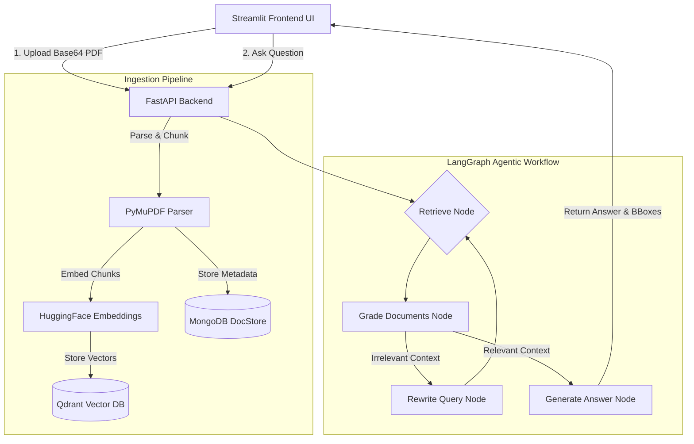

<div align="center">
  <div style="margin: 20px 0;">
    
  </div>

  # 🚀 PolicyAnalyser – Advanced Agentic RAG for Legal Documents
  
  **A 100% Free, High-Performance, Self-Correcting RAG Architecture**

  [](https://www.python.org/)
  [](https://fastapi.tiangolo.com/)
  [](https://streamlit.io/)
  [](https://python.langchain.com/docs/langgraph)
  [](https://qdrant.tech/)
  [](https://www.mongodb.com/)
</div>

---

## 📖 Overview

**PolicyAnalyser** is an enterprise-grade Legal Document Assistant designed to ingest dense legal contracts, policies, and PDFs, allowing users to "chat" with their documents. 

Unlike standard RAG pipelines that blindly retrieve and generate, PolicyAnalyser utilizes **Agentic RAG (CRAG - Corrective RAG)** via **LangGraph**. The AI agent actively grades its own retrieved context. If the context is irrelevant, the agent rewrites its own search query and tries again, significantly reducing hallucinations and improving precision in strict legal environments.

Furthermore, this architecture is meticulously designed to be **100% Free** by leveraging generous cloud free-tiers and high-performance Open Source local tooling.

---

## ✨ Key Features & Upgrades

- 🧠 **Agentic LangGraph Routing (CRAG)**: An advanced multi-node graph that grades retrieved documents and rewrites queries if the context is insufficient.
- ⚡ **Zero-Cost Lightning LLMs**: Integrated with **Groq API** (Llama-3 70B) for near-instant reasoning, falling back to Google Gemini's free tier.
- 🎯 **Local PDF Bounding Boxes**: Completely bypasses expensive paid API parsers (like Unstructured) by utilizing `PyMuPDF` locally to extract exact `(x0, y0, x1, y1)` bounding box coordinates for frontend text highlighting.
- 🗄️ **Robust Dual-Database Architecture**:
  - **Qdrant Cloud**: Stores high-dimensional `sentence-transformer` embeddings for lightning-fast semantic retrieval.
  - **MongoDB Atlas**: Acts as the reliable Document Store, holding the full chunk texts and complex metadata (bounding boxes, page numbers) outside the vector space.
- 🎨 **Beautiful Streamlit UI**: A clean, modern chat interface that handles asynchronous PDF ingestion and real-time streaming of bounding-box references.

---

## 🏗️ System Architecture



---

## 📁 Project Structure

```text
PolicyAnalyser/
├── agent/                  # LangGraph Agentic AI Logic
│   ├── graph.py            # CRAG Workflow definition and state management
│   └── retriever.py        # Qdrant + MongoDB Hybrid Retriever
├── ingestion/              # Document Processing Pipeline
│   ├── indexer.py          # Vector embedding and DB ingestion
│   └── parser.py           # PyMuPDF local chunking and BBox extraction
├── ui/                     # Frontend Application
│   └── ui_app.py           # Streamlit Chat interface
├── .env.example            # Environment variables template
├── app.py                  # FastAPI Backend entry point
├── config.py               # Pydantic Settings manager
└── requirements.txt        # Project dependencies
```

---

## 🚀 Setup & Installation

### 1. Prerequisites
- **Python 3.10+**
- A free **Groq API Key** (or Gemini API Key).
- A free **Qdrant Cloud** cluster URL (or local Docker instance).
- A free **MongoDB Atlas** connection string (or local Docker instance).

### 2. Environment Setup
Clone the repository and install the dependencies:

```bash
# Create a virtual environment
python -m venv venv

# Activate the environment
# On Windows:
venv\Scripts\activate
# On Mac/Linux:
source venv/bin/activate

# Install all dependencies
pip install -r requirements.txt
```

### 3. Configuration
Copy the environment template and fill in your free-tier keys:

```bash
cp .env.example .env
```
Update `.env`:
```env
GROQ_API_KEY=gsk_your_api_key_here
MONGODB_URL=mongodb+srv://<user>:<pass>@cluster.mongodb.net/
QDRANT_URL=https://your-cluster-url.aws.cloud.qdrant.io
QDRANT_API_KEY=your_qdrant_api_key
```

### 4. Running the Application

This architecture separates the backend and frontend. You will need two terminal windows.

**Terminal 1: Start the FastAPI Backend**
```bash
uvicorn app:app --host 0.0.0.0 --port 8000 --reload
```

**Terminal 2: Start the Streamlit UI**
```bash
streamlit run ui/ui_app.py
```

Navigate to `http://localhost:8501` in your browser to start uploading PDFs and chatting!

---

## 🌐 API Reference

If you wish to consume the backend directly via another application (e.g., a Next.js frontend), PolicyAnalyser exposes the following REST endpoints:

- `POST /upload-documents`
  - **Headers**: `document-id`
  - **Body**: `{"file": "<base64_encoded_pdf>"}`
  - **Action**: Parses the PDF, generates embeddings locally, and pushes to Qdrant & MongoDB.

- `POST /ask`
  - **Headers**: `document-id`
  - **Body**: `{"question": "What is the termination clause?"}`
  - **Action**: Triggers the LangGraph agent to retrieve, grade, self-correct, and generate an answer accompanied by PDF bounding box coordinates.

- `GET /health`
  - **Action**: Checks API status and active LLM configuration.

---

## 🔮 Future Enhancements

- **GraphRAG Integration**: Integrate Neo4j to extract knowledge graphs (Entities: *Parties, Liabilities, Dates*) directly from contracts to answer complex multi-hop reasoning questions.
- **Cross-Encoder Re-ranking**: Add a HuggingFace Cross-Encoder node directly after the retriever to sort the contexts with absolute precision.
- **Automated Evaluation**: Integrate `Ragas` to programmatically benchmark the faithfulness and answer relevancy of the agent.

---
*Built with ❤️ for modern Agentic AI workflows.*
